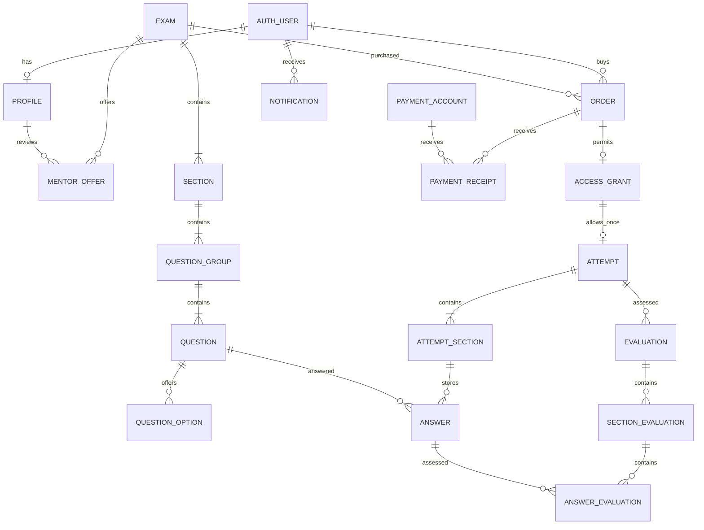

# IELTS Volume — baza sxemasi

Talablar: [requirements.md](requirements.md). Diagramma: [database.dbml](database.dbml).
Sxema Django modellari va `0001_initial` migratsiyalarida amalga oshirilgan.
PostgreSQL — asosiy baza. `auth_user` almashtirilmagan; mavjud foydalanuvchilar saqlanadi.

## Ilovalar

| Ilova | Modellar | Vazifasi |
| --- | --- | --- |
| accounts | Profile, TelegramChallenge | Student/mentor, Telegram va telefon tasdig‘i ma’lumotlari |
| exams | Exam, MentorOffer, Section, QuestionGroup, Question, QuestionOption | Academic mock, savollar, mentor takliflari |
| billing | PaymentAccount, Order, PaymentReceipt, AccessGrant | Karta, xarid, chek, tasdiq, ruxsat |
| attempts | Attempt, AttemptSection, Answer | Bir martalik urinish, taymerlar, javoblar |
| attempts | Evaluation, SectionEvaluation, AnswerEvaluation | Alohida AI/mentor baholari, feedbacklar |
| notifications | Notification | Sayt va Telegram bildirishnomalari navbati |

## Asosiy bog‘lanishlar



## Baza darajasidagi himoya

- Order summasi `base_price + mentor_price` bilan teng; narxlar manfiy emas.
- Mentorsiz buyurtmada mentor uchun qo‘shimcha narx bo‘lmaydi.
- Bitta orderga ko‘pi bilan bitta tasdiqlangan chek va bitta access.
- Accessga ko‘pi bilan bitta attempt: parallel so‘rov ham ikkinchi urinish yarata olmaydi.
- Attempt/section/question kesimida bitta javob saqlanadi.
- Har attempt uchun bitta AI va bitta mentor evaluation bo‘lishi mumkin.
- AI evaluationda mentor yo‘q; mentor evaluationda mentor va deadline majburiy.
- Band qiymatlari `0..9`, faqat `0.5` qadamda. Baholanmagan natija `NULL`.
- Muhim tarixiy bog‘lanishlar `PROTECT` bilan o‘chirishdan himoyalangan.

`choices` va jadvallararo qoidalar uchun `full_clean()` ham kerak: Django `save()` uni
avtomatik chaqirmaydi. Quyidagi servislar yozuvlarni transaction ichida tekshiradi.

## Hozir mavjud servislar

- `billing.services.create_order`: server narxini oladi; imtihon nomi, mentor nomi va narxlarni xaridga nusxalaydi. Bitta xarid bitta imtihon uchun.
- `submit_receipt`: chekni saqlaydi, orderni tekshiruvga o‘tkazadi, vakolatli adminlarga ikkala kanal uchun notification yaratadi.
- `review_receipt`: admin huquqlarini tekshiradi; orderni lock qilib chek tasdig‘i, paid holati va accessni atomar saqlaydi. Takroriy tasdiq yangi access yaratmaydi.
- `attempts.services.start_attempt`: egasi, access holati va ogohlantirish tasdig‘ini tekshiradi. Birinchi bo‘lim taymerini boshlaydi; davom etishda taymer yangilanmaydi.
- `submit_attempt`: barcha bo‘limlar tugatilganini tekshiradi; AI navbat yozuvi va kerak bo‘lsa mentor uchun 12 soatlik deadline yaratadi. Mentorga sayt/bot notification yozuvlari qo‘shiladi.
- `complete_mentor_evaluation`: aynan tanlangan mentorligini, barcha bo‘limlarda ball va matn/audio feedback borligini tekshiradi. Studentga notification yoziladi.

12 soat — mentor topshirig‘ining muddati. Kechikkan feedbackni bloklamaymiz;
kechikishni dashboardda ko‘rsatish va eslatmalar keyingi bosqichda qilinadi.

## Keyingi bosqichdagi majburiy qoidalar

Hozir modellar, boshlang‘ich servislar va testlar bor. Quyidagilar hali amalga oshirilmagan:

- Telegram kontakti yuboruvchiga tegishli ekanini tekshirish, OTP yaratish/tekshirish,
  amal qilish muddati, urinish limiti va rate limit. OTP bazada faqat hash sifatida saqlanadi.
- Publish qilishda IELTS savol turlari, javob kalitlari va bo‘limlar tarkibini to‘liq tekshirish.
- Sotib olingan kontentni muzlatish: dashboard eski kontent tahriri o‘rniga yangi Exam
  versiyasi yaratishi kerak. `previous_version` tayyor; oddiy model `save()`i hozir tahrirni bloklamaydi.
- Javoblarni saqlashda JSON format, option IDlari, question/section mosligi va deadline
  tekshiruvi. Tugatilgan urinishni tahrirlash yopilishi kerak.
- Bo‘limlar ketma-ketligi, server taymeri, uzilishdan davom ettirish va avtomatik topshirish.
- Speakingda bir martalik yozish sessiyasi va audio almashtirishni bloklash.
  Timestamp maydonlari bor, audio yozish oqimi hali yo‘q.
- Reading/Listening tekshiruvi, Academic band konvertatsiyasi, AI worker va retry.
- Qisman tayyor natijalarni ajratish, to‘g‘ri javoblarni faqat tugagach ko‘rsatish.
  Overall faqat to‘rtta bo‘limli mockda hisoblanadi.
- Chek/audio haqiqiy formati va hajmini tekshirish, vakolatli fayl endpointlari.
  Hozir receipt maydonida faqat kengaytma validatori bor; `MEDIA_ROOT` ommaga ochilmagan.
- Notification worker, Telegram yetkazish/retry, saytda o‘qilgan holati.
  Tashqi xabarlar hali yuborilmaydi.
- Refund/revoke oqimi, account anonimlashtirish va audit interfeysi.

## Tekshirish va diagrammani yangilash

```bash
docker compose exec -T web python manage.py check
docker compose exec -T web python manage.py makemigrations --check --dry-run
docker compose exec -T web python manage.py test --noinput
docker compose exec -T web python manage.py shell < scripts/export_schema.py
```

DBML modellardan generatsiya qilinadi. CHECK va shartli unique cheklovlar jadval
izohlarida ko‘rsatiladi; haqiqiy cheklov manbasi — Django migratsiyalari.
